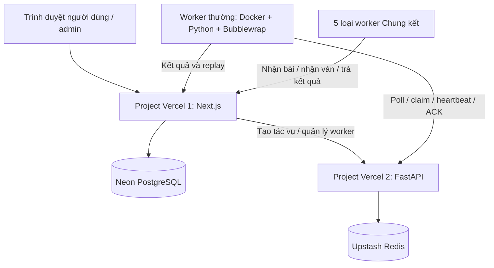

# 🏆 OTTv2 Arena — Hệ Thống Đánh Giá & Thi Đấu Agent AI Oẳn Tù Tì

<p align="center">
  
  
  
  
  
  
</p>


Oantuti là hệ thống thi đấu bot Python trên bàn cờ Oẳn Tù Tì 9×9. Người chơi lập trình agent, nộp bài lên website, thử sức với agent khác và tham gia bảng xếp hạng TrueSkill. Hệ thống hỗ trợ thi đấu cá nhân, thi đấu theo đội và giải Chung kết top 16.

Hệ thống được host bằng **hai project Vercel độc lập**: một project chạy **Next.js**, một project chạy **FastAPI**. Các trận đấu được thực thi trên máy worker có Docker, kết nối tới hai project qua HTTPS. Tài liệu này mô tả hệ thống và cách cài worker.

## Mục lục

- [Kiến trúc hệ thống](#kiến-trúc-hệ-thống)
- [Luật chơi](#luật-chơi)
- [Viết agent Python](#viết-agent-python)
- [Tính năng người dùng](#tính-năng-người-dùng)
- [Tính năng quản trị](#tính-năng-quản-trị)
- [Cài đặt worker thường](#cài-đặt-worker-thường)
- [Cài đặt worker Chung kết](#cài-đặt-worker-chung-kết)
- [Cấu trúc repository](#cấu-trúc-repository)

## Kiến trúc hệ thống



| Thành phần | Công nghệ | Trách nhiệm |
| --- | --- | --- |
| Website và API nghiệp vụ | Next.js 15, React 19, TypeScript, Tailwind CSS | Giao diện, đăng nhập, phân quyền, quản lý đội/agent, xếp hạng, thách đấu, Chung kết và trang admin. |
| API điều phối | FastAPI, Python | Nhận tác vụ từ Next.js; quản lý queue, đăng ký worker, heartbeat, quyền sở hữu tác vụ và điều khiển worker. |
| Dữ liệu lâu dài | Neon PostgreSQL | Tài khoản, đội, mã nguồn agent, lịch sử kiểm tra, trận đấu, rating, replay và dữ liệu Chung kết. |
| Hàng đợi và trạng thái điều phối | Upstash Redis qua REST | Tác vụ chờ, lease, heartbeat và cấu hình điều khiển worker thường. |
| Worker thường | Docker, Python, Bubblewrap | Chạy self-play kiểm tra agent, trận rating và thách đấu; gửi kết quả về Next.js. |
| Worker Chung kết | Docker, engine riêng từng vòng | Kiểm tra bài và chạy ván theo engine đã chọn của vòng; giao tiếp trực tiếp với Next.js bằng token riêng. |

**Next.js vừa phục vụ giao diện vừa xử lý nghiệp vụ phía server**, với các API trong `Frontend/app/api/`. FastAPI đảm nhận điều phối thực thi. Mã Python của người chơi chạy trong sandbox trên worker, không chạy trong request Vercel. Worker thường không cần truy cập trực tiếp Neon hoặc nhận credential Redis.

### Luồng xử lý bài nộp và trận đấu

1. Người dùng thao tác trên website; Next.js kiểm tra phiên đăng nhập, quyền sở hữu và lưu dữ liệu vào PostgreSQL.
2. Next.js gửi tác vụ sang FastAPI bằng secret nội bộ. FastAPI đưa tác vụ vào Redis.
3. Worker chủ động hỏi lấy việc, claim tác vụ và duy trì lease/heartbeat trong lúc chạy. Một lượt giao việc có một worker sở hữu.
4. Worker chạy engine; mỗi lượt gọi agent trong một process Python mới được cách ly bằng Bubblewrap.
5. Worker gửi kết quả và replay về API Next.js. Next.js cập nhật trạng thái bài nộp hoặc kết quả trận, rating và lịch sử tương ứng.
6. Worker xác nhận hoàn thành tác vụ với backend. Cơ chế lease, retry và token thực thi giúp thu hồi tác vụ khi mất kết nối và ngăn callback cũ ghi đè kết quả.

Worker chỉ cần kết nối ra ngoài để gọi API; không cần mở cổng public hay dùng tunnel trên máy worker. Có thể bổ sung nhiều máy worker dùng chung hai project Vercel để tăng năng lực xử lý.

Luồng Chung kết độc lập: worker đúng vòng nhận việc từ API nội bộ Next.js, dùng đúng engine/checksum đã chọn và trả kết quả về đó; không đi qua queue Redis của worker thường.

## Luật chơi

### Bàn cờ và quân cờ

- Bàn cờ **9×9**, cột `a`–`i`, hàng `1`–`9`. Trong code, cột và hàng đều đánh số `0`–`8`.
- Hai bên lần lượt đi, P1 đi trước. Mỗi bên có **10 quân**: 3 Búa, 4 Bao, 3 Kéo.
- Mỗi nước di chuyển một quân sang ô liền kề theo một trong **8 hướng**, gồm ngang, dọc và chéo.
- Có thể đi vào ô trống; chỉ được ăn quân đối phương mà loại quân của mình khắc chế. Không đi vào ô có quân mình, quân cùng loại của đối phương hoặc quân khắc chế mình.

| Quân | Giá trị trong code | Ăn được |
| --- | --- | --- |
| Búa ✊ | `ROCK` | Kéo |
| Bao ✋ | `PAPER` | Búa |
| Kéo ✌️ | `SCISSORS` | Bao |

Vị trí khởi đầu, theo ký hiệu cột trước rồi hàng:

| Bên | Búa | Bao | Kéo |
| --- | --- | --- | --- |
| P1 | b4, c3, d2 | b5, c4, d3, e2 | c5, d4, e3 |
| P2 | f8, g7, h6 | e8, f7, g6, h5 | e7, f6, g5 |

### Thắng, thua và hòa

- **Chiếm căn cứ:** P1 đưa bất kỳ quân nào tới `i9`, hoặc P2 đưa quân tới `a1`.
- **Triệt tiêu một loại quân:** ăn hết Búa, hết Bao hoặc hết Kéo của đối phương là thắng; không cần ăn hết toàn bộ quân.
- **Lỗi agent:** lỗi Python, nước đi sai, không trả nước đi hoặc vượt giới hạn thực thi khiến agent thua trong trận thường. Lỗi khởi tạo sandbox được phân loại là lỗi hạ tầng.
- **Rating và thách đấu:** tối đa **200 nước tổng hai bên**; chưa có bên thắng thì hòa. Worker thường hiện không kết thúc sớm vì lặp thế cờ.
- **Self-play kiểm tra bài:** tối đa **60 nước**, nhằm kiểm tra khả năng thực thi và trả nước hợp lệ; hòa không đồng nghĩa bài lỗi.
- **Chung kết:** dùng engine và bộ luật đã khóa của từng vòng. Các engine ban đầu dùng giới hạn **150 nước**, hòa khi cùng thế cờ và cùng bên tới lượt xuất hiện lần thứ ba. Cần xem thông tin vòng trước khi nộp bài.

## Viết agent Python

Người chơi lập trình hàm có tên `agent`:

```python
def agent(observation, configuration):
    moves = observation.get("valid_moves", [])
    if not moves:
        return None

    # Ví dụ: ưu tiên ăn quân, nếu không thì đi nước đầu tiên.
    chosen = next((move for move in moves if move["is_capture"]), moves[0])
    return {
        "from_col": chosen["from_col"],
        "from_row": chosen["from_row"],
        "to_col": chosen["to_col"],
        "to_row": chosen["to_row"],
    }
```

| Trường trong observation | Ý nghĩa |
| --- | --- |
| `board` | Danh sách phẳng 81 ô; truy cập bằng `board[row * 9 + col]`. |
| `board_2d` | Bàn cờ hai chiều, truy cập bằng `board_2d[row][col]`. |
| Giá trị mỗi ô | `None` hoặc object như `{"player": 1, "type": "ROCK"}`. |
| `current_player` | Bên đang tới lượt: `1` hoặc `2`. |
| `valid_moves` | Các nước hợp lệ, gồm bốn tọa độ và cờ `is_capture`. |
| `piece_counts` | Số quân mỗi loại của từng bên. Sau khi truyền qua JSON, khóa bên chơi là chuỗi `"1"`, `"2"`. |
| `move_count` | Tổng số nước đã thực hiện. |
| `game_over` | Trạng thái kết thúc ván. |

`configuration` hiện là dict rỗng trong worker thường. Chung kết có thể bổ sung dữ liệu theo hợp đồng engine, gồm trường `finals` trong observation.

Agent phải **return** nước đi; chỉ `print` tọa độ không thay thế kết quả trả về. Trả `None` được xem là không có nước đi và dẫn tới thua trong trận thường.

### Môi trường chạy agent

- Mỗi lượt tạo process mới: biến global và dữ liệu RAM không được giữ qua lượt sau.
- Có Python standard library; không hỗ trợ tự cài thư viện ngoài như NumPy/Pandas.
- Sandbox chặn mạng, tạo process/thread và ghi file; mã agent không nhìn thấy `.env`, secrets hoặc thư mục ứng dụng của worker.
- Mỗi lượt có giới hạn CPU, thời gian thực, bộ nhớ và tổng stdout/stderr. Không nên in log quá nhiều.

Mặc định worker thường: CPU **10 giây/lượt**, thời gian thực **12 giây/lượt**, bộ nhớ địa chỉ **128 MiB**, stdout/stderr cộng lại **64 KiB**, mã nguồn tối đa **1 MiB**. Giới hạn bộ nhớ dùng `RLIMIT_AS`, không phải dung lượng RSS. Các giá trị do người vận hành cấu hình; worker Chung kết có cấu hình riêng.

## Tính năng người dùng

### Tài khoản và bắt đầu sử dụng

Người dùng có thể đăng ký, đăng nhập và đăng xuất. Mật khẩu được băm bằng bcrypt; phiên đăng nhập dùng JWT trong cookie. Khách có thể xem các trang công khai như dashboard, bảng xếp hạng và thông tin Chung kết đã công bố. Nộp bài và thách đấu yêu cầu đăng nhập.

Quy trình tham gia:

1. Đăng ký/đăng nhập; nếu thi đấu theo đội, tạo hoặc tham gia đội trước khi nộp bài.
2. Vào **Nộp Agent** (`/arena/submit`), đặt tên, mô tả và nhập mã Python trong trình soạn thảo.
3. Chọn giữ riêng tư hoặc công khai. Bài nộp được đưa vào self-play để tự kiểm tra.
4. Theo dõi kết quả; nếu lỗi, đọc thông báo rồi sửa code và nộp phiên bản mới.
5. Dùng agent hợp lệ để thách đấu; công khai agent khi muốn tham gia rating và bảng xếp hạng.
6. Theo dõi lịch sử, biểu đồ điểm và replay để cải thiện thuật toán.

### Quản lý agent và quyền riêng tư

- Xem danh sách bài nộp, phiên bản, trạng thái kiểm tra và thông báo lỗi trong phạm vi cá nhân hoặc đội hiện tại.
- Hệ thống nhận diện code trùng trong cùng phạm vi cá nhân/đội để tránh nộp lại cùng bài.
- Agent mới mặc định riêng tư. Agent hợp lệ riêng tư có thể dùng để thử sức với agent công khai của người khác.
- Có thể công khai agent đã hợp lệ. **Công khai là thao tác một chiều**: hiện không hỗ trợ chuyển lại thành riêng tư.
- Công khai cho phép agent xuất hiện trong chức năng công khai và tham gia rating; không có nghĩa người khác được tải mã nguồn. Quyền đọc code vẫn theo chủ sở hữu, thành viên đội và admin.

### Bảng xếp hạng TrueSkill

Trang `/arena/leaderboard` hiển thị thành tích cá nhân và đội. Mỗi cá nhân/đội được đại diện bằng agent phù hợp theo chính sách xếp hạng; cần ít nhất **10 trận hợp lệ** để có thứ hạng chính thức.

Điểm hiển thị khởi đầu là **1000**, tính từ sức mạnh ước lượng `mu` của TrueSkill. `sigma` thể hiện độ bất định và được dùng để tính mức tin cậy. Hệ thống tự ghép cặp đánh giá agent, không yêu cầu người chơi tự tạo trận rating.

Scheduler điều chỉnh số trận theo nhu cầu đánh giá: mặc định agent ổn định khi có ít nhất 10 trận hợp lệ và `sigma ≤ 2.5`, ngân sách tối đa 20 trận/agent trong 24 giờ. Agent ổn định vẫn có thể làm đối thủ đánh giá agent mới; worker rảnh không nhất thiết tạo thêm trận rating.

Khi rating hòa sau giới hạn nước, mỗi bên bị trừ **4–32 điểm** theo số quân địch còn lại và khoảng cách trung bình quân mình tới đích. Hòa vẫn giảm độ bất định. Mỗi cặp tối đa hai trận hòa trong 24 giờ trước khi scheduler tìm đối thủ khác. Thách đấu không áp dụng cập nhật rating này.

Trang chi tiết agent và lịch sử cho phép xem thắng/thua/hòa, thay đổi điểm, biểu đồ rating, phiên bản và replay theo quyền truy cập.

### Thách đấu riêng tư

Tại `/arena/friendly`, chọn agent của cá nhân/đội mình và agent công khai hợp lệ của đối thủ để chạy một trận thử. Trận được xếp hàng trực tiếp, không cần gửi lời mời rồi chờ đối thủ chấp nhận.

- Tối đa **10 trận/người/ngày**, đặt lại theo múi giờ `Asia/Ho_Chi_Minh`.
- Chọn bên P1/P2 thông qua vị trí hai agent.
- Kết quả và replay thuộc phạm vi truy cập của trận riêng tư, không tự đưa lên lịch sử công khai.
- Không ảnh hưởng rating hoặc thứ hạng. Gửi lại cùng mã yêu cầu không tạo trận trùng hay trừ thêm lượt.

### Đội thi đấu

Trang `/team` hỗ trợ đội tối đa **3 thành viên**, gồm trưởng đội:

- Tạo đội, cập nhật thông tin và trạng thái tuyển thành viên.
- Trưởng đội gửi/hủy lời mời, duyệt hoặc từ chối yêu cầu xin vào và quản lý thành viên.
- Người dùng nhận lời/từ chối lời mời, xin vào đội đang tuyển, hủy yêu cầu hoặc rời đội theo điều kiện hệ thống.
- Thành viên cùng quản lý bài nộp thuộc đội. Khi đang ở đội, phạm vi nộp bài là đội hiện tại; bài cá nhân cũ vẫn được lưu.
- Đội được xếp hạng như một đơn vị thi đấu. Chỉ admin có quyền giải thể đội; lịch sử agent, rating và replay được giữ lại.

### Chung kết top 16

Trang `/finals` hiển thị giải, nhánh đấu và kết quả/replay đã công bố. Người có suất vào trang giải `/finals/<id>` để nộp **Agent dự thi Chung kết**.

- Nhánh đấu gồm vòng 16, tứ kết, bán kết, chung kết và tranh hạng ba. Hai nhánh cuối lấy kết quả từ bán kết.
- Mỗi vòng phải nộp bài mới, có thể giữ nguyên code vòng trước. Agent rating không được tự lấy làm bài Chung kết.
- Đối với suất đội, quyền nộp và xem code dựa trên danh sách thành viên tại thời điểm chốt suất.
- Bản nộp mới nhất phải vượt qua kiểm tra của đúng engine vòng đó. Bản mới lỗi không tự quay về dùng bản cũ.
- Khi admin khóa bài, các ván dùng snapshot mã nguồn và engine đã khóa. Mỗi cặp có hai ván đổi bên.
- Kết quả cặp có hiệu lực sau khi admin xác nhận. Chung kết độc lập với rating và thách đấu thường.

## Tính năng quản trị

Các trang `/admin/*` và API quản trị yêu cầu tài khoản có quyền admin.

| Trang | Chức năng |
| --- | --- |
| `/admin/agents` | Lọc agent theo trạng thái, xem mã nguồn/lỗi kiểm tra và chỉ số; từ chối bài, hủy kích hoạt hoặc yêu cầu tự kiểm tra lại. Duyệt hợp lệ thông thường được thực hiện tự động qua self-play. |
| `/admin/teams` | Xem đội, trưởng đội, số thành viên/agent và trạng thái; giải thể đội, giữ dữ liệu lịch sử. |
| `/admin/rating` | Theo dõi hàng đợi TrueSkill và tiến độ đánh giá; bật/tạm dừng tạo trận rating; dựng lại điểm từ lịch sử. |
| `/admin/workers` | Xem worker thường, heartbeat, lỗi, tác vụ và slot; bật, tạm dừng/tiếp tục, dừng chờ hoàn tất hoặc dừng ngay; chỉnh concurrency riêng từng worker. |
| `/admin/settings` | Kiểm tra backend, queue, worker và thống kê validation/rating/thách đấu; xem trận gần đây; đưa trận kẹt về pending hoặc error. URL backend được đọc từ biến môi trường. |
| `/admin/finals` | Tạo giải/chốt top 16, chọn engine từng vòng, mở nhận bài, khóa bài/mở đấu, theo dõi ván, xác nhận kết quả cặp và công bố kết quả/replay. |

**Tạm dừng scheduler rating** chỉ dừng tạo thêm rating, khác với dừng runtime worker. Worker còn hoạt động vẫn có thể xử lý các loại tác vụ khác.

Với Chung kết, admin có thể ngắt/chạy lại ván lỗi, chỉ định kết quả, tải bundle bài đã khóa để chạy offline và nhập bản ghi JSON. Bản ghi nhập được kiểm tra cấu trúc và gắn nhãn tin admin; không được coi là bằng chứng tự động rằng mọi nước đi đúng luật. Worker Chung kết không tự xử thua hoặc tự retry lỗi ván thay quyết định của admin.

## Cài đặt worker thường

Worker này xử lý **validation, rating và thách đấu**. Có thể build từ repository để dùng mã nguồn hiện tại hoặc dùng ZIP có sẵn image.

### Yêu cầu

- Docker Engine và **Docker Compose v2** (`docker compose`).
- Linux hỗ trợ **unprivileged user namespaces** để Bubblewrap tạo sandbox. Trên Windows, dùng Docker Desktop với WSL 2 và Linux containers.
- Kết nối tới URL HTTPS của cả frontend Next.js và backend FastAPI.
- `WORKER_SECRET` từ quản trị backend và `WORKER_CALLBACK_SECRET` từ quản trị frontend.
- Compose mặc định giới hạn container ở **4 CPU, 1 GiB RAM**; cần tính thêm tài nguyên cho hệ điều hành/Docker và điều chỉnh concurrency phù hợp.

Worker thường không cần Judge0, Docker-in-Docker, Docker socket hoặc cổng inbound public.

### Cách 1: Chạy từ mã nguồn

Từ thư mục gốc repository sau khi tải/clone mã nguồn:

```bash
cp worker_image/.env.example worker_image/.env
```

Mở `worker_image/.env` và điền cấu hình thực:

```dotenv
BACKEND_URL=https://YOUR-FASTAPI-PROJECT.vercel.app
FRONTEND_URL=https://YOUR-NEXTJS-PROJECT.vercel.app
WORKER_SECRET=SECRET_DA_CAU_HINH_O_BACKEND
WORKER_CALLBACK_SECRET=SECRET_DA_CAU_HINH_O_FRONTEND

WORKER_ID=local-python
MAX_CONCURRENT=4
POLL_INTERVAL=1

AGENT_CPU_SECONDS=10
AGENT_WALL_SECONDS=12
AGENT_MEMORY_MB=128
AGENT_OUTPUT_BYTES=65536
AGENT_SOURCE_BYTES=1048576
```

Thay các chuỗi mẫu bằng giá trị thật. Dùng URL gốc của từng project, không thêm `/api` vào cuối; không dùng `localhost` để chỉ tới dịch vụ Vercel.

| Biến | Cách sử dụng |
| --- | --- |
| `BACKEND_URL` | URL project FastAPI: đăng ký, nhận việc và heartbeat. |
| `FRONTEND_URL` | URL project Next.js: gửi kết quả/callback và phối hợp điều phối. |
| `WORKER_SECRET` | Phải giống `WORKER_SECRET` phía FastAPI. |
| `WORKER_CALLBACK_SECRET` | Phải giống `WORKER_CALLBACK_SECRET` phía Next.js. |
| `WORKER_ID` | Tên worker trên máy; định danh thực còn kết hợp machine identity. |
| `MAX_CONCURRENT` | Số job đồng thời khi đăng ký lần đầu; sau đó lấy giá trị được lưu/điều khiển từ admin. |
| `POLL_INTERVAL` | Khoảng nghỉ hỏi tác vụ, tính bằng giây. |
| `AGENT_*` | Giới hạn mỗi lượt agent như phần môi trường chạy ở trên. |

Chạy:

```bash
bash dockerworker.sh
```

Script tự build image, self-check sandbox và tạo lại container ở chế độ nền. Nếu self-check thất bại, cần xử lý lỗi host trước khi nhận bài; worker không tự chuyển sang chạy code không cách ly.

Các lệnh vận hành:

```bash
bash dockerworker.sh status
bash dockerworker.sh logs
bash dockerworker.sh check
bash dockerworker.sh stop
bash dockerworker.sh update
```

`update` build lại từ mã nguồn hiện có và tạo lại container; cần cập nhật mã nguồn trước nếu muốn lấy bản mới. `Ctrl+C` khi xem log chỉ thoát trình xem log. Trên Linux, nếu chưa có quyền Docker, có thể chạy script với `sudo` theo cấu hình máy.

Có thể dùng Compose trực tiếp thay script:

```bash
docker compose -f worker_image/compose.yaml build worker-python
docker compose -f worker_image/compose.yaml run --rm worker-python --check
docker compose -f worker_image/compose.yaml up -d worker-python
```

Chỉ thực hiện `up` khi self-check thành công.

### Cách 2: Dùng ZIP có sẵn image

Gói portable dành cho **Intel/AMD 64-bit** chứa image và script chạy, không cần build trên máy nhận. Gói công khai không chứa secrets. ZIP là một bản phát hành riêng; nếu cần mã nguồn/engine mới nhất trong repository, dùng cách 1 hoặc gói được quản trị viên xuất lại.

**Linux:**

```bash
wget -O oantuti-worker.zip "https://github.com/tuanngthuet/oantuti/releases/download/worker-portable-v1/oantuti-worker.zip"
unzip oantuti-worker.zip
cd oantuti-worker
cp .env.example .env
```

Mở `.env`, kiểm tra hai URL Vercel và điền `WORKER_SECRET`, `WORKER_CALLBACK_SECRET`, rồi chạy:

```bash
bash worker.sh
bash worker.sh logs
# Khi cần dừng:
bash worker.sh stop
```

**Windows — PowerShell**, sau khi Docker Desktop đã chạy:

```powershell
curl.exe -fL "https://github.com/tuanngthuet/oantuti/releases/download/worker-portable-v1/oantuti-worker.zip" -o oantuti-worker.zip
Expand-Archive .\oantuti-worker.zip -DestinationPath .
cd oantuti-worker
Copy-Item .env.example .env
notepad .env
```

Lưu URL/secrets đúng trong `.env`, sau đó:

```powershell
.\worker.cmd
.\worker.cmd logs
# Khi cần dừng:
.\worker.cmd stop
```

Script portable tự nạp image, kiểm tra sandbox và chạy nền. Định danh máy được giữ trong Docker volume.

### Kiểm tra và vận hành

1. Kiểm tra container bằng `status`, xem log để xác nhận đăng ký/heartbeat thành công.
2. Mở `/admin/workers` trên frontend để kiểm tra worker, trạng thái và concurrency.
3. Nếu admin đang lưu trạng thái dừng, bấm **Bật worker**. Khởi động lại container không xóa lựa chọn dừng trước đó.
4. Nộp một agent mẫu, theo dõi self-play hoàn tất để kiểm tra cả queue và callback.

Nhiều máy có thể dùng cùng tên `local-python`; trên **cùng một máy**, các instance phải có tên khác nhau. Compose từ mã nguồn dùng `/etc/machine-id` để giữ identity qua lần tạo lại container. Có thể đặt `MACHINE_ID` ổn định khi môi trường không cung cấp identity phù hợp; không dùng chung identity cho nhiều máy.

Pause không ngắt trận đang chạy. Dừng chờ hoàn tất cho phép xử lý xong trước khi tắt runtime; dừng ngay sẽ hủy runner đang chạy. Supervisor vẫn online để nhận lệnh bật lại khi container còn chạy. Tắt container bằng script sẽ dừng cả supervisor.

| Hiện tượng | Kiểm tra |
| --- | --- |
| Không kết nối Docker | Docker daemon/Desktop đã mở, Compose v2 có sẵn và tài khoản có quyền truy cập Docker. |
| Self-check lỗi namespace/Bubblewrap | Host hoặc LXC/managed có chặn user namespaces không; Windows đã dùng Linux containers/WSL 2 chưa. |
| API trả `401`/`403` | URL và secret tương ứng; kiểm tra cả chính sách bảo vệ truy cập của project. |
| Online nhưng không nhận việc | Worker có pause/stop không, còn slot không, queue có tác vụ không; rating có đang bật và cần đánh giá thêm không. |
| Đã chạy nhưng web chưa có kết quả | Callback tới Next.js, URL frontend, secret callback và log retry. |
| Worker hay hết RAM | Giảm concurrency trên admin hoặc chỉnh tài nguyên container; giới hạn mỗi agent không phải tổng bộ nhớ cả worker. |

Không commit/chia sẻ `.env` hoặc gói portable riêng có nhúng secrets. Xem thêm [worker_image/README.md](worker_image/README.md) và [worker_image/PORTABLE.md](worker_image/PORTABLE.md).

## Cài đặt worker Chung kết

Chỉ cần phần này khi tổ chức giải Chung kết. Worker thường không thay thế worker Chung kết. Có năm service:

| Service | Vòng |
| --- | --- |
| `round_16` | Vòng 16 |
| `quarterfinal` | Tứ kết |
| `semifinal` | Bán kết |
| `final` | Chung kết |
| `third_place` | Tranh hạng ba |

### Chuẩn bị credential

Cần Docker/Compose, host hỗ trợ sandbox như worker thường và Python 3 để tạo cấu hình. Từ gốc repository:

```bash
python3 worker_ck/configure.py --url https://YOUR-NEXTJS-PROJECT.vercel.app
```

Lệnh tạo năm file `worker_ck/.env.<service>` và `worker_ck/.env.frontend` với token riêng từng vòng; từ chối ghi đè cấu hình đã tồn tại. Worker Chung kết dùng URL **Next.js**, không dùng URL FastAPI.

Quản trị frontend cần cấu hình `CK_WORKER_TOKENS` khớp giá trị trong `.env.frontend` trước khi worker kết nối. Đây là JSON object có khóa `1`–`5`; khi nhập vào trường giá trị môi trường, dùng nội dung JSON, không kèm tiền tố `CK_WORKER_TOKENS=` hoặc dấu nháy đơn bao ngoài của file shell. Nếu hệ thống đã có bộ token, dùng credential được quản trị viên cấp thay vì tạo bộ mới làm lệch cấu hình.

Database cần có schema Chung kết tương ứng. Quy trình nâng cấp schema và giữ dữ liệu được mô tả trong [worker_ck/README.md](worker_ck/README.md).

### Build, kiểm tra và chạy

```bash
docker compose -f worker_ck/compose.yaml build
```

Kiểm tra đủ năm image:

```bash
docker compose -f worker_ck/compose.yaml run --rm round_16 --check
docker compose -f worker_ck/compose.yaml run --rm quarterfinal --check
docker compose -f worker_ck/compose.yaml run --rm semifinal --check
docker compose -f worker_ck/compose.yaml run --rm final --check
docker compose -f worker_ck/compose.yaml run --rm third_place --check
```

Sau khi tất cả self-check thành công:

```bash
docker compose -f worker_ck/compose.yaml up -d
docker compose -f worker_ck/compose.yaml ps
docker compose -f worker_ck/compose.yaml logs -f --tail 100
# Khi cần dừng:
docker compose -f worker_ck/compose.yaml stop
```

Mỗi instance mặc định xử lý một job; mỗi lượt agent mặc định CPU **2 giây**, thời gian thực **4 giây**, RAM địa chỉ **128 MiB**, output **64 KiB**, source **1 MiB**. Mỗi service có giới hạn container riêng; cần dự trù tài nguyên khi chạy cả năm.

Admin chọn engine/checksum đã đăng ký cho đúng vòng tại `/admin/finals` trước khi mở nhận bài. Không có worker đúng engine thì bài tiếp tục chờ. Sau khi khóa bài/mở đấu, giữ đúng image/checksum phục vụ ván và chạy lại. Mỗi vòng dùng engine riêng; sửa engine một vòng không tự cập nhật các vòng khác.

Xem [worker_ck/README.md](worker_ck/README.md) về cấu hình nhiều instance, engine, bundle offline và replay.

## Cấu trúc repository

```text
Oantuti/
├── Frontend/                 # Next.js: UI, API nghiệp vụ và PostgreSQL
│   ├── app/                  # Trang user/admin và API route
│   ├── components/           # Bàn cờ, replay, biểu đồ, giao diện Chung kết
│   ├── lib/                  # Auth, database, rating, đội và Chung kết
│   └── scripts/              # Migration, kiểm thử và dữ liệu demo
├── backend/                  # FastAPI: điều phối và Redis
│   ├── api/index.py          # Entrypoint cho Vercel
│   └── app/                  # Router, cấu hình và dịch vụ điều phối
├── worker_image/             # Worker thường, engine, sandbox, portable và test
├── worker_ck/                # Khung chung và năm worker engine Chung kết
├── local_runner/             # Công cụ runner cục bộ bổ sung
├── dockerworker.sh           # Build/check/chạy/quản lý worker thường
└── README.md
```

Mẫu cấu hình: [Frontend/.env.example](Frontend/.env.example), [backend/.env.example](backend/.env.example), [worker_image/.env.example](worker_image/.env.example) và [worker_ck/.env.example](worker_ck/.env.example). Secrets phải khớp đúng vai trò: `INTERNAL_BACKEND_SECRET` dùng cho Next.js → FastAPI, không thay thế hai secret của worker thường.
